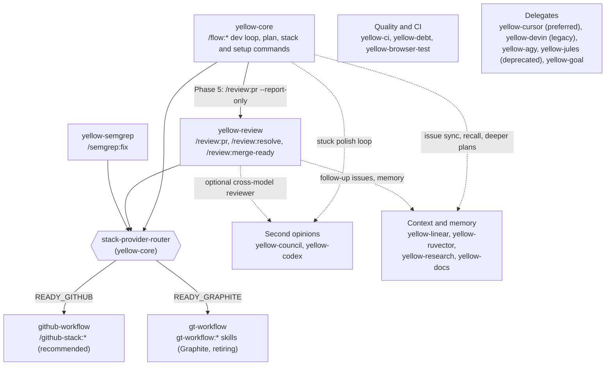
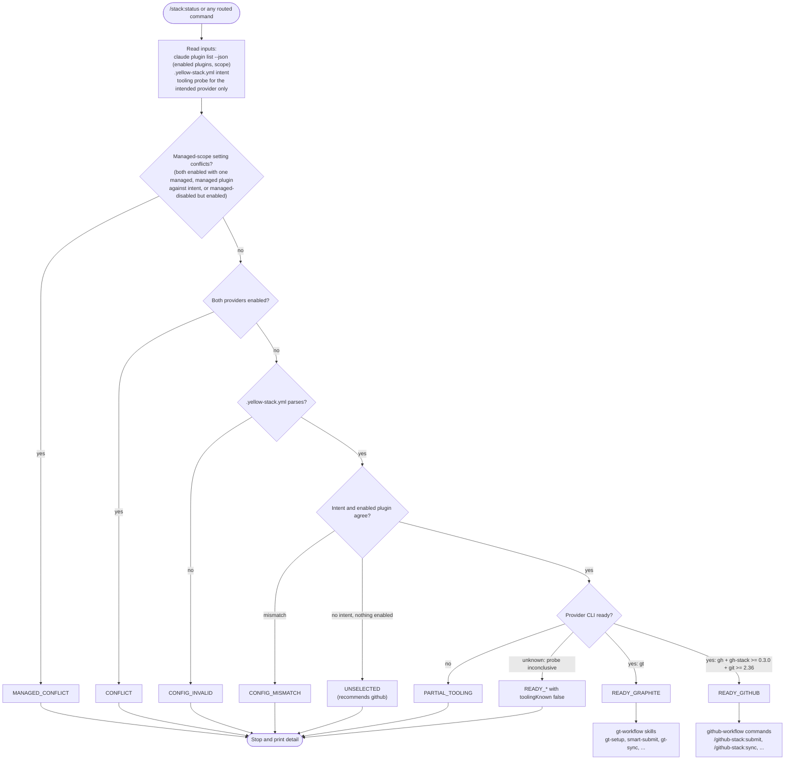
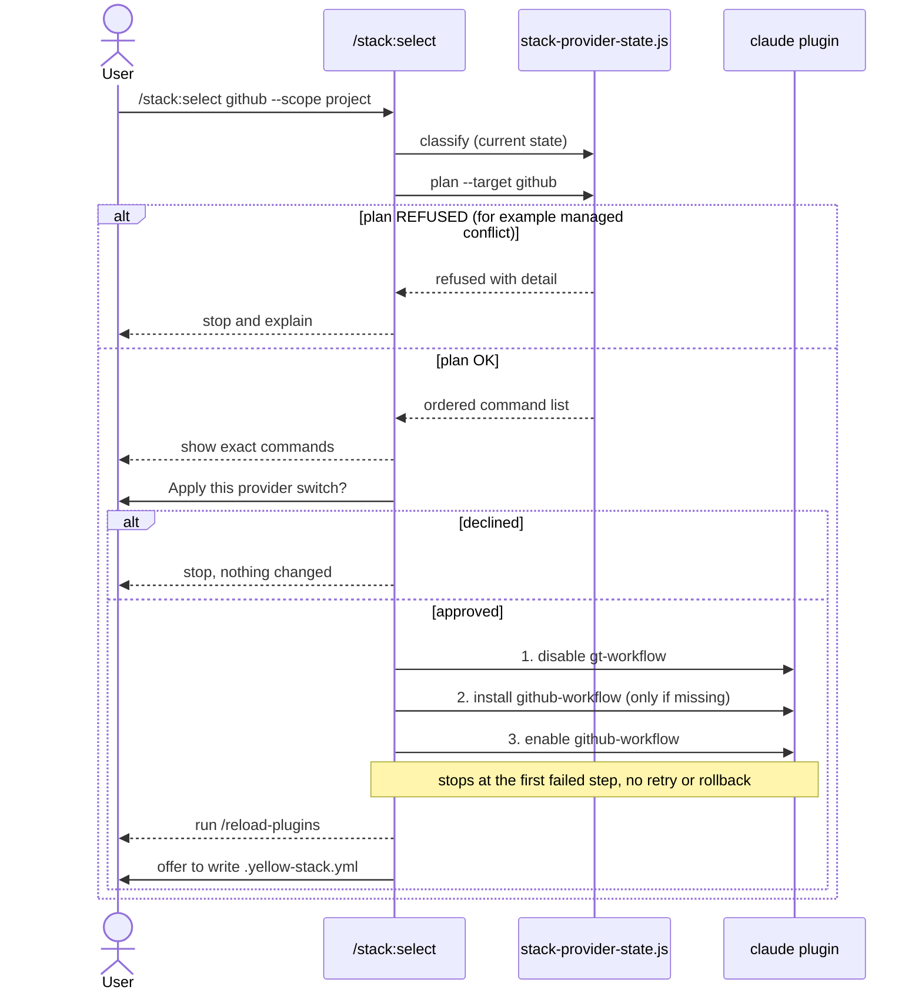
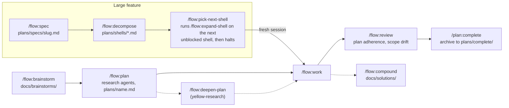
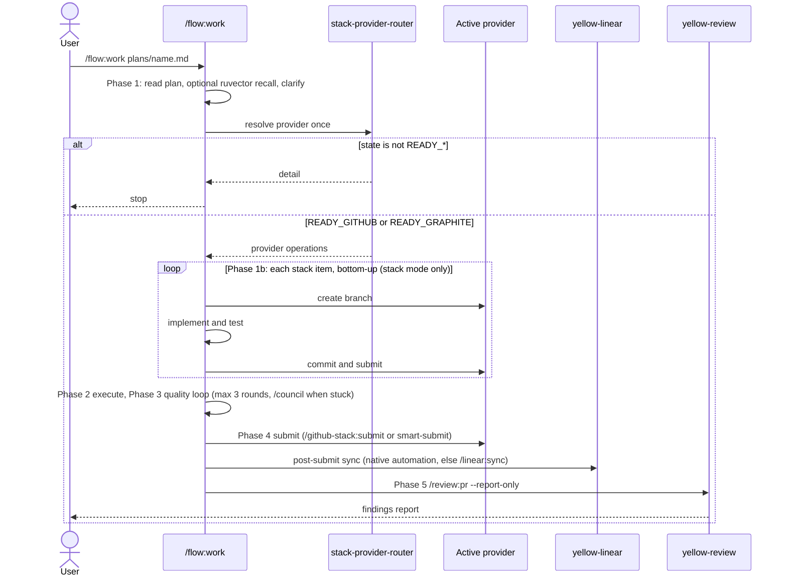
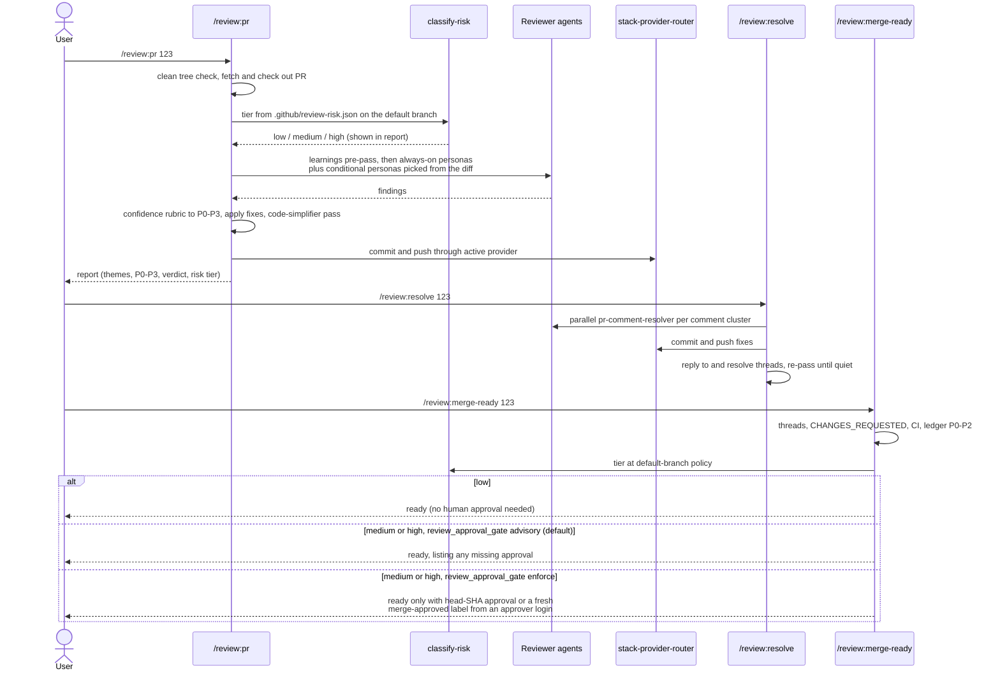
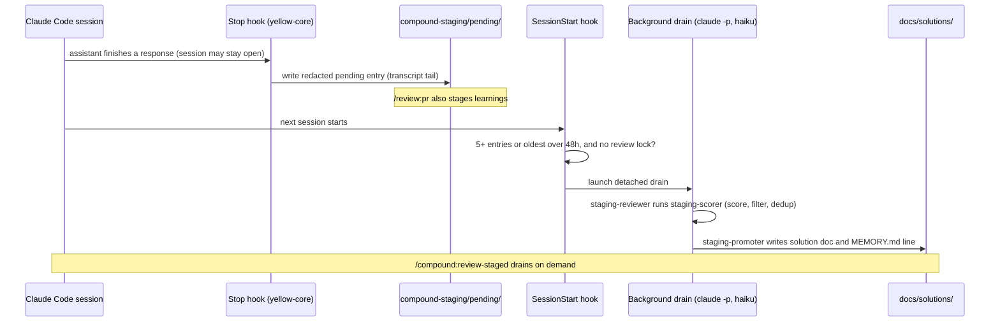
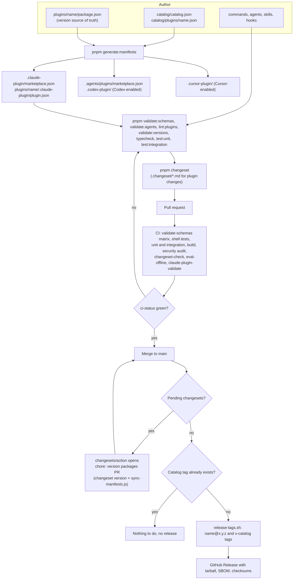

# Workflow Diagrams

Mermaid diagrams of how the marketplace's plugins work together and how a change
to this repository is validated and released. GitHub renders them inline. Each
section names the files that define the behaviour, so check those when a diagram
and the code disagree.

- [Marketplace at a glance](#marketplace-at-a-glance)
- [Stacked-PR provider selection](#stacked-pr-provider-selection)
- [Development loop (`/flow:*`)](#development-loop-flow)
- [PR review and merge gate (`/review:*`)](#pr-review-and-merge-gate-review)
- [Knowledge compounding](#knowledge-compounding)
- [Build, validation and release](#build-validation-and-release)

For the component-level architecture (catalog, generator, hooks, CI), see
[architecture-overview.md](architecture-overview.md). For a per-plugin list of
commands, see [commands-reference.md](commands-reference.md).

## Marketplace at a glance

yellow-core owns the development loop and the stack router. Every plugin that
branches, commits or submits goes through the router to whichever stacked-PR
provider is enabled, never to raw `git push` or `gh pr create`.

Quality, delegate and utility plugins (`yellow-composio`, `yellow-morph`,
`yellow-claudemod`) run on their own commands. Remote delegates such as
yellow-cursor's cloud agents open their own pull requests and do not use the
router.

## Stacked-PR provider selection

`/stack:status` classifies the provider state and the `stack-provider-router`
skill routes only the two `READY_*` states. Every other state stops with the
classifier's `detail`; there is no fallback to the other provider.

Defined in `plugins/yellow-core/lib/stack-provider-state.js` (states and
precedence), `stack-tooling-probe.js`, `stack-operation-registry.js` (operation
to provider mapping) and `commands/stack/{status,select}.md`.

Switching providers is `/stack:select`, which shows its plan before acting:

Both providers also register a `PreToolUse` hook (`check-git-push`) and a
`PostToolUse` hook (`check-commit-message`) that warns on non-conventional
commit messages. The push hooks differ: gt-workflow's denies a raw `git push`,
because a push outside `gt submit` leaves Graphite's metadata stale.
github-workflow's allows a plain `git push` and denies only pushes that can
rewrite or delete a branch a stack builds on (force, delete or mirror pushes).

## Development loop (`/flow:*`)

Defined in `plugins/yellow-core/commands/flow/` and `commands/plan/`. Large
features go through spec and shells first; smaller ones start at brainstorm or
plan.

Inside `/flow:work`, the router is resolved once and every branch, commit and
submit goes through the active provider:

## PR review and merge gate (`/review:*`)

Defined in `plugins/yellow-review/commands/review/`. `/review:sweep` runs
`/review:pr` then `/review:resolve` unattended; `/review:sweep-all` does that
for every open non-draft PR you authored.

## Knowledge compounding

Two paths write solution docs to `docs/solutions/`: the manual `/flow:compound`,
and a background staging ledger fed by yellow-core's Stop hook and by
`/review:pr`. Defined in `plugins/yellow-core/CLAUDE.md` "Compound Staging" and
the `staging-*` agents.

## Build, validation and release

How a change to this repository is generated, validated and released. Defined in
`scripts/generate-manifests.js`, `package.json` scripts,
`.github/workflows/validate-schemas.yml` and
`.github/workflows/version-packages.yml`. See
[operations/release-checklist.md](operations/release-checklist.md) for the
release runbook.

